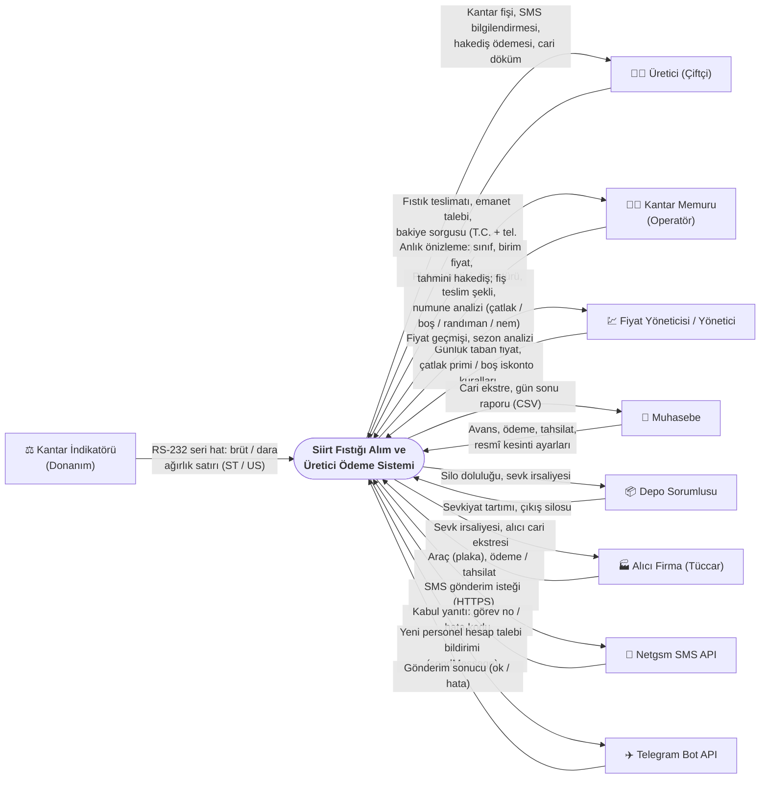

# 01 · Kapsam, Sistem Sınırı ve Aktörler

> BMH-405 Yazılım Mühendisliği · Hafta 5 — Sistem sınırları ve kapsam diyagramı
> İlgili belgeler: [Gereksinimler (SRS)](GEREKSINIMLER.md) · [UML](UML.md) · [02 Belirsizlik kaydı](02_BELIRSIZLIK_KAYDI.md) · [03 Kabul kriterleri](03_KABUL_KRITERLERI_VE_KALITE.md)

Bu belge, sistemin **neyi yaptığını ve neyi yapmadığını** tek bakışta göstermek için yazıldı. Sınırın içinde kalan her modül çalışan kodda karşılığı olan bir bileşendir; sınırın dışında kalanlar ise sistemle yalnızca tanımlı bir arayüz (ekran, HTTP API, seri port) üzerinden konuşur.

---

## 1. Sistem sınırı

### 1.1 Sınırın içinde kalanlar (sistemin sorumluluğu)

| Modül | Sorumluluğu | Koddaki karşılığı |
|---|---|---|
| **Tartım (kantar)** | Brüt / dara / çuval darası, net kg; ağırlığın kaynağını (kantar `K` / elle `E`) kaydetme; fiş ve lot numarası | `TartimServisi`, panelde `SeriKantar` (Web Serial) |
| **Kalite analizi ve sınıflandırma** | Çatlak, randıman, boş, çürük, nem; numune gramlarından oran hesabı; A / B / ISK, YA / YB / YISK sınıfı | `Kurallar.sinifBelirle`, `quality_grades` |
| **Fiyat kilidi** | Tartım anındaki onaylı taban fiyat + çatlak primi − boş tane iskontosu; bir kez yazılır, değiştirilemez | `Kurallar.fiyatKilitle`, `trg_weigh_tickets_freeze` |
| **Hakediş ve kesintiler** | Brüt tutar, resmî kesintiler (stopaj, borsa, SGK/Bağ-Kur, komisyon), net hakediş | `Kurallar.hakedisOlustur`, `trg_settlements_freeze` |
| **Avans ve mahsup** | Teslimattan önce/sonra avans; açık avansların hakedişten **FIFO** mahsubu; eksi bakiye | `Kurallar.avansMahsupPlani` |
| **Ödeme** | Parçalı / tam ödeme; nakit, havale, çek; değiştirilemez cari hesap defteri | `FinansServisi`, `trg_ledger_append_only` |
| **Emanet** | Satılmadan depoya bırakılan fıstık; o günün fiyatıyla parça parça satışa çevirme (EB fişi, lot bölme) | `Kurallar.emanetiSatisaCevir` |
| **Silo / lot stoğu** | Kaliteye adanmış silolar, kapasite, karışık sınıf yasağı; sevkiyatta lotlardan **FIFO** çıkış (önce merkezin malı, emanet en son) | `Kurallar.silodanSevkEt`, `trg_stock_grade_check`, `trg_stock_non_negative` |
| **Sevkiyat ve alıcı cari** | Alıcıya çıkış tartımı, sevk irsaliyesi, peşin / havale / vadeli satış, tahsilat, alıcı ekstresi | `SevkiyatServisi` |
| **Raporlar** | Günlük özet, gün sonu (CSV), müstahsil cari dökümü (A4), grafikli sezon analizi | `RaporServisi`, `CsvRaporu` |
| **Kullanıcı ve yetki** | Giriş (JWT), 6 rol, hesap talebi ve onayı, her kaydın işlemi yapan kişiyle imzalanması | `GuvenlikAyarlari`, `Kullanicilar` |
| **Üretici sorgu ekranı** | Üreticinin şifresiz, T.C. + telefonun son 4 hanesiyle kendi bakiye ve emanet özetini görmesi | `Sorgu` |
| **Bildirim adaptörleri** | SMS ve Telegram mesajını oluşturma ve dış servise gönderme (hata işlemi bozmaz) | `SmsServisi`, `TelegramBildirimServisi` |
| **Veri deposu** | PostgreSQL şeması, tetikleyiciler ve görünümler (Flyway V1–V10) | `db/migration` |

### 1.2 Sınırın dışında kalanlar (kapsam dışı)

| Kapsam dışı | Neden / nasıl ele alınıyor |
|---|---|
| Kantar indikatörünün kendisi, kalibrasyonu ve damgası | Donanımdır; sistem yalnızca gönderdiği ağırlık satırını okur. |
| Bankaya EFT / havale emri gönderme | Ödeme dışarıda yapılır; sistem ödemeyi, yöntemini ve dekont numarasını **kaydeder**. |
| e-Müstahsil makbuzu, e-Fatura, GİB entegrasyonu | Resmî belge düzenleme kapsam dışı; kesinti tutarları hesaplanır ve dökümde gösterilir (gelecek çalışma). |
| Muhasebe programına (Logo, Mikro…) aktarma | Gün sonu raporu Excel'de açılan CSV olarak alınır. |
| Alıcıların sipariş / sözleşme yönetimi | Sevkiyat, araç kantara geldiğinde depo sorumlusu tarafından kaydedilir; sipariş sistemde tutulmaz. |
| SMS teslim raporunun (DLR) izlenmesi | Netgsm'in kabul yanıtı (görev no / hata kodu) kaydedilir; telefona ulaşıp ulaşmadığı sorgulanmaz. |
| Telegram'dan gelen mesajları okuma (iki yönlü bot) | Yalnızca yöneticiye bildirim gönderilir. |

---

## 2. Kapsam diyagramı (context diagram)

Merkezdeki tek kutu sistemin tamamıdır; oklar üzerinde **ne aktığı** yazılıdır. Sistemin kendi iç modülleri bu diyagramda gösterilmez (bkz. [UML bileşen diyagramı](UML.md)).

**Okuma notları**

- **Kantar indikatörü** seri porttan (RS-232, bilgisayarda USB-seri dönüştürücü ile) sürekli ağırlık satırı gönderir (ör. `ST,GS,+004800kg`). Sistem `ST` (kararlı) satırını bekler, `US` (kararsız, araç sallanıyor) satırını kullanmaz. Okuma tarayıcıdaki Web Serial API ile kantar bilgisayarında yapılır; ağırlık sunucuya tartım kaydıyla birlikte gider.
- **Alıcı firma** sisteme doğrudan giriş yapmaz; aracı kantara geldiğinde depo sorumlusu sevkiyatı kaydeder, muhasebe tahsilatı işler. Okun "alıcı → sistem" yönü bu fiziksel girdiyi gösterir.
- **Üretici** yalnızca kendi bakiye / emanet özetini görebildiği sorgu ekranıyla sisteme doğrudan dokunur; başka hiçbir veriye erişemez.
- **Netgsm** ve **Telegram** hata verirse veya ulaşılamazsa asıl işlem (tartım, hesap talebi) yine tamamlanır; bildirim işlem kaydedildikten sonra gönderilir.

### 2.1 Aktör listesi

| Aktör | Tür | Sistemle arayüzü | Rolü sistemde |
|---|---|---|---|
| Üretici (çiftçi) | Birincil olmayan insan aktör | Kantar fişi, SMS, sorgu ekranı | Kayıtlı üretici (rol yok; şifresiz sorgu) |
| Kantar memuru | Birincil insan aktör | Web paneli, klavye kısayolları (F2 / F3 / F9) | `SCALE_OPERATOR` |
| Kalite sorumlusu | Birincil insan aktör | Web paneli | `QUALITY` |
| Fiyat yöneticisi | Birincil insan aktör | Web paneli | `PRICE_MANAGER` |
| Muhasebe | Birincil insan aktör | Web paneli | `ACCOUNTING` |
| Depo sorumlusu | Birincil insan aktör | Web paneli | `WAREHOUSE` |
| Yönetici | Birincil insan aktör | Web paneli | `ADMIN` (tüm işlemler, kullanıcılar) |
| Alıcı firma | Dış paydaş | Sevk irsaliyesi, ekstre (kâğıt / PDF) | Müşteri kaydı (rol yok) |
| Kantar indikatörü | Dış donanım | RS-232 seri hat → Web Serial API | — |
| Netgsm SMS API | Dış sistem | HTTPS GET | — |
| Telegram Bot API | Dış sistem | HTTPS POST `sendMessage` | — |

---

## 3. Kullanım senaryosu: UC-01 Kantar Tartımı ve Fiyat Kilitleme

*Cockburn "tam giydirilmiş" (fully dressed) biçimi.*

| Alan | İçerik |
|---|---|
| **Kapsam** | Siirt Fıstığı Alım ve Üretici Ödeme Sistemi |
| **Düzey** | Kullanıcı hedefi (deniz seviyesi) |
| **Birincil aktör** | Kantar memuru |
| **Paydaşlar ve ilgileri** | **Üretici:** fıstığının doğru tartılması ve tartım anındaki fiyattan ödenmesi. **Merkez:** fiyatın sonradan değiştirilememesi, stoğun kaliteye göre doğru siloya girmesi. **Muhasebe:** kesinti ve avans mahsubunun otomatik ve izlenebilir olması. |
| **Ön koşullar** | Memur oturum açmıştır ve `tartim` yetkisi vardır. Üretici kayıtlıdır. Hemen satışta, ürün türünün ilgili sınıfı için o an geçerli onaylı taban fiyat vardır. |
| **Tetikleyici** | Üreticinin aracı dolu olarak kantara çıkar. |
| **Başarı garantisi (son koşul)** | Tek bir veritabanı işleminde: fiş ve lot oluşmuş, kalite sınıfı belirlenmiş, birim fiyat kilitlenmiş, kesintiler ve avans mahsubu hesaplanmış, hakediş ve cari hareket yazılmış, lot uygun siloya yerleşmiştir. Fiş basılır, üreticiye SMS gider. |
| **Asgari garanti** | Herhangi bir adım başarısız olursa hiçbir kayıt oluşmaz (işlem geri alınır); kullanıcıya nedeni Türkçe gösterilir. |

### Ana başarı senaryosu

1. Memur araç plakasını yazar, üreticiyi adla veya T.C. ile arayıp seçer.
2. Memur **F2** ile brüt ağırlığı kantardan okutur. Sistem kararlı (`ST`) değeri alır, alanı kilitler ve kaynağı *kantar* olarak işaretler.
3. Araç boşaltılıp yeniden tartılır; memur **F3** ile darayı okutur. Çuval varsa çuval sayısını girer.
4. Memur ürün türünü (kuru-kavlak / yaş) ve teslim şeklini (*hemen satış*) seçer.
5. Memur numune analiz değerlerini (çatlak, randıman, boş, çürük, nem — ya da numune gramlarını) girer.
6. Sistem her değişiklikte, kayıt yapmadan, kalite sınıfını, birim fiyatı (taban + prim − iskonto), kesintileri, avans mahsubunu ve net hakedişi **canlı önizleme** olarak gösterir.
7. Memur **F9** ile kaydeder.
8. Sistem tek işlemde: fiş ve lot numarası üretir, sınıfı belirler, **o anki onaylı fiyatı kilitler**, hakedişi ve cari hareketi yazar, lotu sınıfa adanmış ve kapasitesi yeten ilk siloya yerleştirir.
9. Sistem termal fişi yazdırır; işlem kaydedildikten sonra üreticiye teslimat SMS'i gönderir.

### Alternatif akışlar (uzantılar)

| No | Koşul | Sistemin davranışı |
|---|---|---|
| **2a** | **İndikatör değeri kararsız** (araç sallanıyor, `US` satırları geliyor) | Sistem en fazla 6 sn kararlı değer bekler; durum bayrağı yoksa art arda 3 aynı değeri kararlı sayar. Alınamazsa "Kararlı değer alınamadı (araç hareket ediyor olabilir). Tekrar deneyin." der; memur tekrar okutur. |
| 2b | Kantar bağlı değil / veri gelmiyor | Memur ağırlığı elle girer; fişte ve kayıtta kaynak **E (elle)** olarak görünür. Kantardan okunmuş değeri düzeltmek de ayrı bir "elle düzelt" eylemi gerektirir ve kaynağı **E**'ye çevirir. |
| **3a** | **Üretici fıstığı emanete bırakmak istiyor** | Memur teslim şeklini *emanete bırak* seçer. Fiyat **kilitlenmez**, hakediş ve cari hareket oluşmaz; lot siloya girer, fiş "emanet belgesi" olarak basılır. Fiyat, üreticinin satışa çevirdiği gün o günün fiyatıyla kilitlenir (UC: Emaneti satışa çevir). Fiyat girilmemiş günde de emanet alınabilir. |
| **5a** | **Numunede boş oranı eşiğin üstünde** | Boş tane iskontosu açıksa (ör. eşik %3, puan başı 5 ₺) aşan her puan için kg başına iskonto uygulanır ve önizlemede uyarı çıkar. Oran sınıfın sınırını da aşarsa (A için boş + çürük ≤ %5) fıstık bir alt sınıfa (B / ISK) düşer ve o sınıfın siloya ve fiyatına gider. |
| 5b | Çatlak oranı baz değerin altında / üstünde | Çatlak primi açıksa (ör. baz %85, puan başı 2 ₺, en fazla ±20 ₺) fark kadar prim veya iskonto uygulanır; sınırda kalır. |
| **8a** | **Üreticinin açık avansı var (eksi bakiye)** | Kesintiler düşüldükten sonra kalan tutar, açık avanslardan en eskisinden başlayarak (FIFO) mahsup edilir. Avans hakedişten büyükse net ödenecek **0 ₺** olur (durum: *yalnızca mahsup*), kalan avans açık kalır, bakiye eksi kalmaya devam eder. |
| 8b | Seçilen sınıf için o an onaylı fiyat yok | Kayıt reddedilir (HTTP 400: "A sınıfı için şu an (…) onaylı fiyat yok."). Memur fiyat yöneticisine haber verir ya da teslimatı emanete alır. |
| 8c | Uygun silonun kapasitesi yetmiyor | Sistem aynı sınıfa adanmış diğer silolara bakar; hiçbiri yetmiyorsa kayıt reddedilir ("uygun silo yok"). |
| 8d | Çuval darası neti sıfıra / eksiye indiriyor | Doğrulama hatası (HTTP 422), kayıt yapılmaz. |
| 9a | SMS sağlayıcısına ulaşılamıyor | Tartım geçerli kalır; SMS kaydı *başarısız* durumunda saklanır. |

**Bu senaryonun kabul testleri:** [03 Kabul kriterleri](03_KABUL_KRITERLERI_VE_KALITE.md) KK-1 (fiyat kilidi), KK-2 (avans mahsubu), KK-3 (prim ve iskonto sınırları) · `tests/test_kabul.py`, `tests/test_api.py::test_tartim_fiyat_kilidi_hakedis_ve_stok`, `tests/test_saha.py::test_agirlik_kaynagi_kaydedilir`.
