# Siirt Fıstığı Alım ve Üretici Ödeme Sistemi — Veritabanı Şeması

Hedef: **PostgreSQL 15+**, ORM: **SQLAlchemy 2.0** (`app/db/models.py`).
Tam DDL: `db/schema.sql` (modellerden üretilir) + `db/postgres_triggers_views.sql`.

## ER Diyagramı

```mermaid
erDiagram
    PRODUCERS ||--o{ PRODUCER_BANK_ACCOUNTS : "sahip"
    PRODUCERS ||--o{ WEIGH_TICKETS : "teslim eder"
    PRODUCERS ||--o{ ADVANCES : "alır"
    PRODUCERS ||--o{ SETTLEMENTS : "hak eder"
    PRODUCERS ||--o{ PAYMENTS : "alır"
    PRODUCERS ||--o{ PRODUCER_LEDGER_ENTRIES : "cari hareket"

    QUALITY_GRADES ||--o{ DAILY_PRICES : "fiyatlanır"
    QUALITY_GRADES ||--o{ QUALITY_INSPECTIONS : "atanır"
    QUALITY_GRADES ||--o{ LOTS : "sınıfı"
    QUALITY_GRADES |o--o{ SILOS : "adanmış sınıf"

    WEIGH_TICKETS ||--o| QUALITY_INSPECTIONS : "analiz (1-1)"
    DAILY_PRICES  |o--o{ WEIGH_TICKETS : "fiyat snapshot"
    WEIGH_TICKETS ||--o| LOTS : "lot (1-1)"
    WEIGH_TICKETS ||--o| SETTLEMENTS : "hakediş (1-1)"

    SETTLEMENTS ||--o{ SETTLEMENT_DEDUCTIONS : "kesintiler"
    DEDUCTION_TYPES ||--o{ SETTLEMENT_DEDUCTIONS : "tür"
    ADVANCES ||--o{ ADVANCE_OFFSETS : "mahsup edilir"
    SETTLEMENTS ||--o{ ADVANCE_OFFSETS : "mahsup eder"
    PAYMENTS ||--o{ PAYMENT_ALLOCATIONS : "dağıtılır"
    SETTLEMENTS ||--o{ PAYMENT_ALLOCATIONS : "ödenir"
    PRODUCER_BANK_ACCOUNTS |o--o{ PAYMENTS : "hesaba"

    LOTS ||--o{ STOCK_MOVEMENTS : "hareket"
    SILOS ||--o{ STOCK_MOVEMENTS : "hareket"
    CUSTOMERS ||--o{ SHIPMENTS : "satın alır"
    CUSTOMERS ||--o{ CUSTOMER_PAYMENTS : "öder"
    SILOS ||--o{ SHIPMENTS : "çıkış"
    SHIPMENTS ||--o{ STOCK_MOVEMENTS : "lot düşümü (DISPATCH)"

    PRODUCERS {
        int id PK
        varchar producer_type "INDIVIDUAL | COMPANY"
        char11 national_id UK "TC (bireyselde zorunlu)"
        char10 tax_number UK "VKN (tüzelde zorunlu)"
        varchar full_name
        varchar phone
    }
    PRODUCER_BANK_ACCOUNTS {
        int id PK
        int producer_id FK
        char26 iban "UK(producer_id, iban)"
        bool is_default "üretici başına tek"
    }
    QUALITY_GRADES {
        int id PK
        varchar code UK
        int priority UK
        numeric min_split_ratio
        numeric min_yield_ratio
        numeric max_defect_ratio
        numeric max_moisture_ratio
    }
    DAILY_PRICES {
        int id PK
        int quality_grade_id FK
        numeric price_per_kg
        timestamptz valid_from
        timestamptz valid_to "NULL=açık uçlu"
        varchar status "DRAFT|APPROVED|REVOKED"
        timestamptz approved_at
        timestamptz revoked_at
    }
    WEIGH_TICKETS {
        int id PK
        varchar ticket_no UK "KF-2026-000001"
        int producer_id FK
        varchar vehicle_plate
        numeric gross_kg
        numeric tare_kg
        numeric net_kg "GENERATED gross-tare"
        timestamptz gross_weighed_at "fiyat referans anı"
        int daily_price_id FK "SNAPSHOT"
        numeric unit_price "SNAPSHOT"
        varchar status
    }
    QUALITY_INSPECTIONS {
        int id PK
        int ticket_id FK,UK
        numeric split_ratio
        numeric yield_ratio
        numeric empty_ratio
        numeric rotten_ratio
        numeric moisture_ratio
        int quality_grade_id FK
    }
    SETTLEMENTS {
        int id PK
        varchar settlement_no UK
        int ticket_id FK,UK
        numeric gross_amount
        numeric deductions_total
        numeric advance_offset_total
        numeric net_payable ">= 0"
        numeric paid_amount "<= net_payable"
        varchar status "UNPAID|PARTIALLY_PAID|PAID|OFFSET_ONLY"
    }
    SETTLEMENT_DEDUCTIONS {
        int id PK
        int settlement_id FK
        int deduction_type_id FK
        numeric rate "snapshot"
        numeric amount
    }
    DEDUCTION_TYPES {
        int id PK
        varchar code UK "STOPAJ, BORSA, KOMISYON"
        varchar calc_method "PERCENT|PER_KG|FIXED"
        numeric rate
    }
    ADVANCES {
        int id PK
        varchar advance_no UK
        int producer_id FK
        numeric amount
        numeric offset_amount
        varchar status
    }
    ADVANCE_OFFSETS {
        int id PK
        int advance_id FK
        int settlement_id FK
        numeric amount
    }
    PAYMENTS {
        int id PK
        varchar payment_no UK
        int producer_id FK
        int bank_account_id FK
        numeric amount
    }
    PAYMENT_ALLOCATIONS {
        int id PK
        int payment_id FK
        int settlement_id FK
        numeric amount
    }
    PRODUCER_LEDGER_ENTRIES {
        bigint id PK
        int producer_id FK
        varchar entry_type
        numeric amount "işaretli"
        timestamptz entry_at
    }
    SILOS {
        int id PK
        varchar code UK
        numeric capacity_kg
        int dedicated_grade_id FK
    }
    LOTS {
        int id PK
        varchar lot_no UK
        int ticket_id FK,UK
        int quality_grade_id FK
        numeric initial_kg
    }
    STOCK_MOVEMENTS {
        bigint id PK
        int lot_id FK
        int silo_id FK
        varchar movement_type
        numeric quantity_kg "işaretli"
        int shipment_id FK "yalnızca DISPATCH"
    }
    SPLIT_PREMIUM_RULES {
        varchar product_type PK "DRY, FRESH"
        numeric base_split_ratio
        numeric premium_per_point
        numeric max_adjustment
        boolean is_active
    }
    CUSTOMERS {
        int id PK
        varchar name UK "Türkçe harf duyarsız"
        varchar tax_number
    }
    CUSTOMER_PAYMENTS {
        int id PK
        varchar receipt_no UK "TH-YYYY-NNNNNN"
        int customer_id FK
        numeric amount
        varchar method "CASH, BANK_TRANSFER, CHEQUE"
        timestamptz received_at
    }
    SHIPMENTS {
        int id PK
        varchar shipment_no UK "SV-YYYY-NNNNNN"
        int customer_id FK
        int silo_id FK
        int quality_grade_id FK
        numeric gross_kg
        numeric tare_kg
        numeric net_kg "hesaplanan"
        numeric unit_price
        numeric total_amount "= net × fiyat"
        varchar collection "CASH, BANK_TRANSFER, ON_ACCOUNT"
    }
```



## Teslimat yaşam döngüsü

```
GROSS_WEIGHED ──dara──▶ NET_WEIGHED ──kalite analizi──▶ GRADED ──hakediş──▶ SETTLED
      │                     │          (sınıf + FİYAT SNAPSHOT + LOT)
      └──────────┬──────────┘
             CANCELLED  (gerekçe zorunlu; SETTLED iptal edilemez)
```

## Kritik iş kuralları → şemadaki karşılığı

| Kural | Nasıl sağlanıyor |
|---|---|
| Aynı gün çoklu teslimat, her biri benzersiz | `weigh_tickets.ticket_no` UNIQUE, `lots.lot_no` UNIQUE; (üretici, tarih) üzerinde UNIQUE **yok**. Numara `document_sequences` satır kilidiyle üretilir. |
| Tartım anındaki fiyat dondurulur | `find_effective_price(grade, gross_weighed_at)` → `weigh_tickets.daily_price_id + unit_price` kopyalanır. Değiştirilemez: ORM `@validates` + `trg_weigh_tickets_freeze`. Onaylı fiyat da değiştirilemez (`trg_daily_prices_guard`); gün içi değişim = eski kaydı kapat + yeni kayıt. |
| Sonradan onaylanan / iptal edilen fiyat | Lookup şartı `approved_at <= tartım anı` ve `revoked_at IS NULL OR revoked_at > tartım anı`. |
| Onaylı fiyatlar çakışmaz | `EXCLUDE USING gist (quality_grade_id WITH =, tstzrange(valid_from, valid_to) WITH &&) WHERE status='APPROVED'` |
| Avans > teslimat → eksi bakiye, sonra mahsup | Avans verildiğinde defter −; hakedişte FIFO mahsup kesinti sonrası tutarla sınırlı (`net_payable >= 0`), kalan avans açık kalır → bakiye eksi. Sonraki hakediş kalan avansı otomatik düşer. |
| Parçalı / tam ödeme | `payment_allocations` → `settlements.paid_amount` ve `status`; CHECK `paid_amount <= net_payable`. Ödeme `min(bakiye, ödenmemiş hakediş)` ile sınırlı. |
| Net hakediş formülü | CHECK `gross_amount = ROUND(net_kg*unit_price,2)` ve `net_payable = gross − kesinti − avans` (PostgreSQL). |
| Denetlenebilirlik | Cari defter append-only (`trg_ledger_append_only`); düzeltme = `REVERSAL` kaydı. Kesinti oranları hakedişte snapshot. |
| Kaliteye göre ayrıştırma | Silo `dedicated_grade_id` + "silo içinde başka sınıf stok yok" kontrolü (servis + `trg_stock_grade_check`). |

## Örnek: avans > teslimat

| Adım | Hakediş (brüt − kesinti) | Avans mahsubu | Net ödenecek | Açık avans | Cari bakiye |
|---|---|---|---|---|---|
| 500.000 TL avans verildi | — | — | — | 500.000 | −500.000 |
| Teslimat 1 | 290.400 | 290.400 | 0 (`OFFSET_ONLY`) | 209.600 | −209.600 |
| Teslimat 2 | 232.320 | 209.600 | 22.720 | 0 | +22.720 |
