# UML Diyagramları

**Proje:** Siirt Fıstığı Alım ve Üretici Ödeme Sistemi · **Sürüm:** 2.0 (Java / Spring Boot)

Diyagramlar [Mermaid](https://mermaid.js.org) ile yazılmıştır; GitHub'da doğrudan çizilir.
Gereksinimler: [GEREKSINIMLER.md](GEREKSINIMLER.md) · Veritabanı ER diyagramı: [ER.md](ER.md)

| # | Diyagram | UML türü | Gösterdiği |
|---|---|---|---|
| 1 | [Kullanım durumu](#1-kullanım-durumu-diyagramı) | Davranışsal | Aktörler ve sistemle yaptıkları işler |
| 2 | [Sınıf (alan modeli)](#2-sınıf-diyagramı--alan-modeli) | Yapısal | Varlıklar, nitelikler ve ilişkiler |
| 3 | [Sınıf (servis katmanı)](#3-sınıf-diyagramı--katmanlar-ve-servisler) | Yapısal | Katmanlar ve işlemler |
| 4 | [Sıralama: fıstık alımı](#4-sıralama-diyagramı--fıstık-alımı-kd-03) | Etkileşim | Tartımdan fişe kadar nesnelerin mesajlaşması |
| 5 | [Sıralama: hakediş ödemesi](#5-sıralama-diyagramı--hakediş-ödemesi-kd-05) | Etkileşim | Avans mahsubu ve parçalı ödeme |
| 6 | [Etkinlik: hakediş hesabı](#6-etkinlik-diyagramı--hakediş-hesabı-ve-avans-mahsubu) | Davranışsal | Net hakediş ve FIFO avans algoritması |
| 7 | [Durum diyagramları](#7-durum-diyagramları) | Davranışsal | Teslimat, hakediş, fiyat ve avans yaşam döngüleri |
| 8 | [Bileşen ve dağıtım](#8-bileşen-ve-dağıtım-diyagramı) | Yapısal | Çalışma zamanı mimarisi |

---

## 1. Kullanım durumu diyagramı

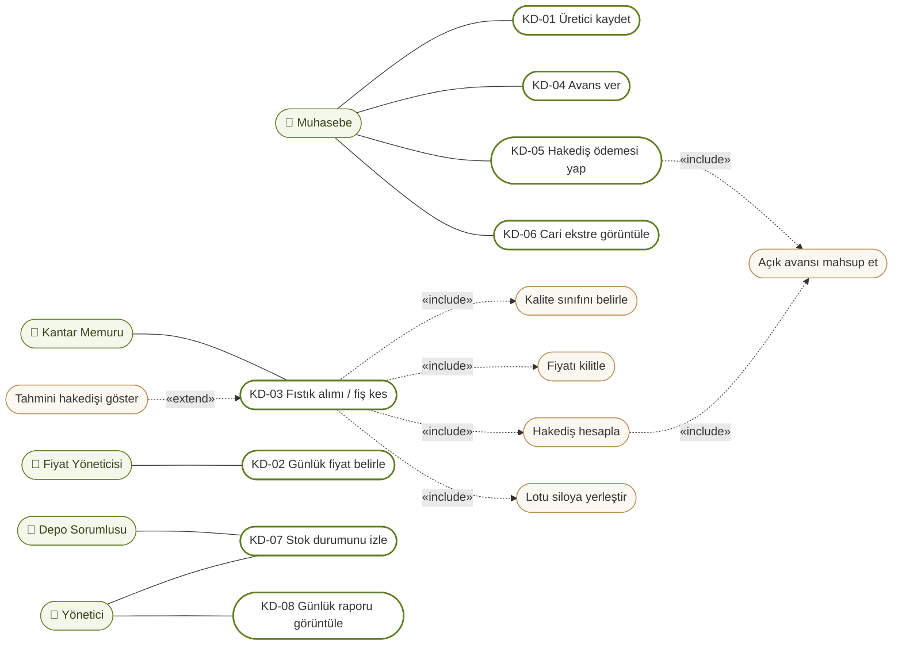

> Sol sütun aktörler (yeşil), orta sütun sistemin kullanım durumları (kalın çerçeve), sağ sütun bunların içerdiği alt işlevlerdir (bej). Tüm kullanım durumları *Siirt Fıstığı Alım ve Üretici Ödeme Sistemi* sınırı içindedir.
> **Yönetici** tüm aktörlerin işlerini yapabilir (genelleme); okları sade tutmak için yalnızca raporlama ilişkileri çizildi.

---

## 2. Sınıf diyagramı — alan modeli

Kalıcı varlıklar (`java-backend/.../alan/*.java`, JPA). Tüm para alanları `BigDecimal` (`NUMERIC`), zamanlar `OffsetDateTime` (`timestamptz`).

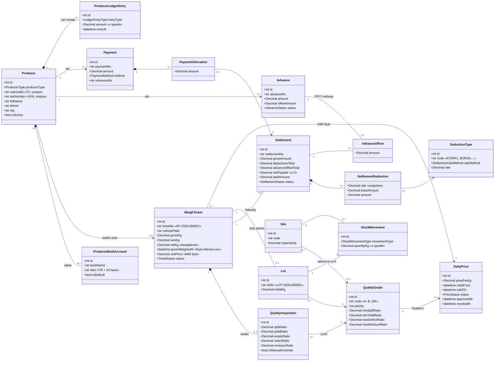

**Notlar**
- `Settlement` ↔ `Advance` arasındaki çoka-çok ilişki, mahsup tutarını taşıyan `AdvanceOffset` ilişki sınıfıyla kurulur. `Payment` ↔ `Settlement` arasındaki ilişki de aynı şekilde `PaymentAllocation` ile kurulur.
- `ProducerLedgerEntry` yalnızca eklenebilir. Üretici bakiyesi = Σ `amount`.
- Kullanıcı (`User`) ve belge numarası sayacı (`DocumentSequence`) diyagramı sade tutmak için gösterilmedi.

---

## 3. Sınıf diyagramı — katmanlar ve servisler

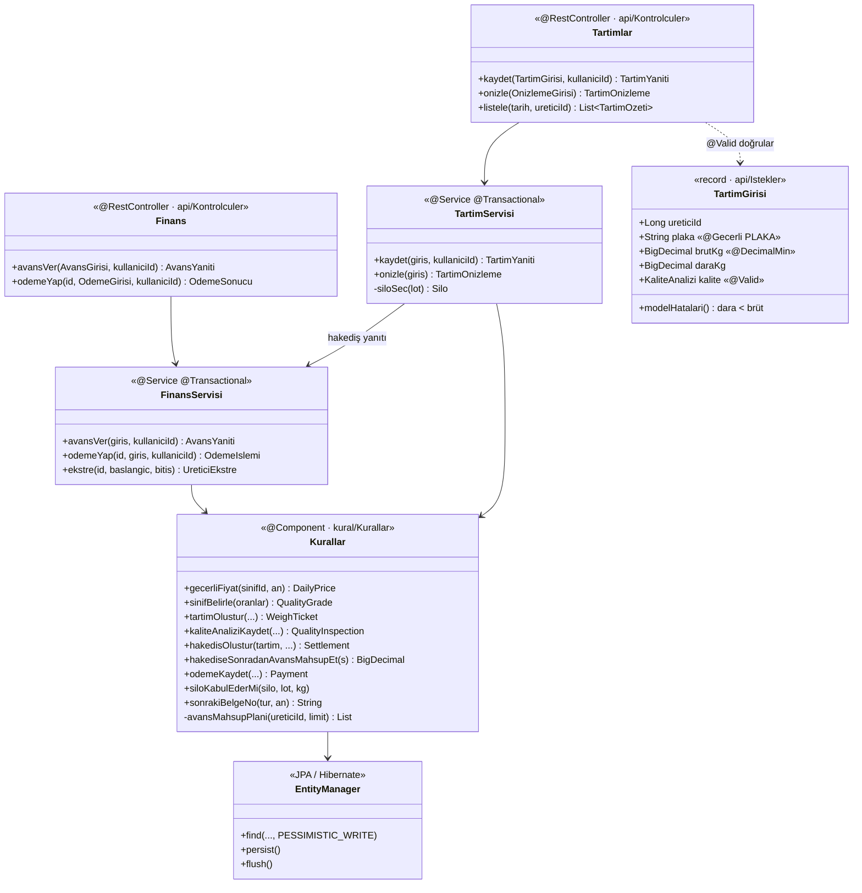

**Bağımlılık kuralı:** Oklar yalnızca aşağı yönlüdür (API → servis → alan → veri). İş kuralları (`Kurallar`) HTTP'yi bilmez; bu sayede doğrudan test edilebilir. Bu ayrım sayesinde Python prototipinden Java'ya geçişte mimari değişmeden kalmıştır.

---

## 4. Sıralama diyagramı — Fıstık alımı (KD-03)

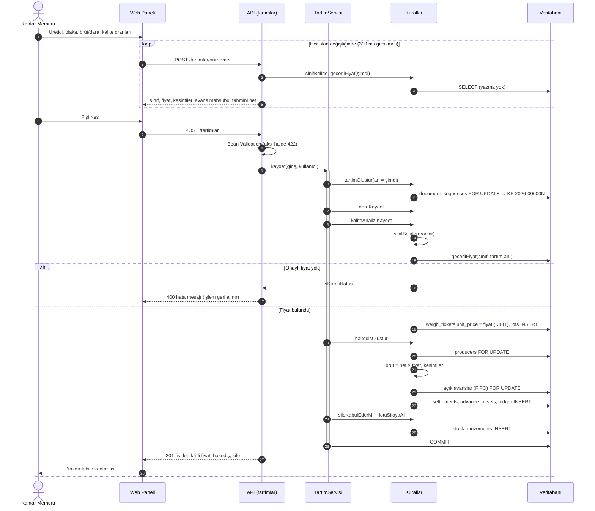

---

## 5. Sıralama diyagramı — Hakediş ödemesi (KD-05)

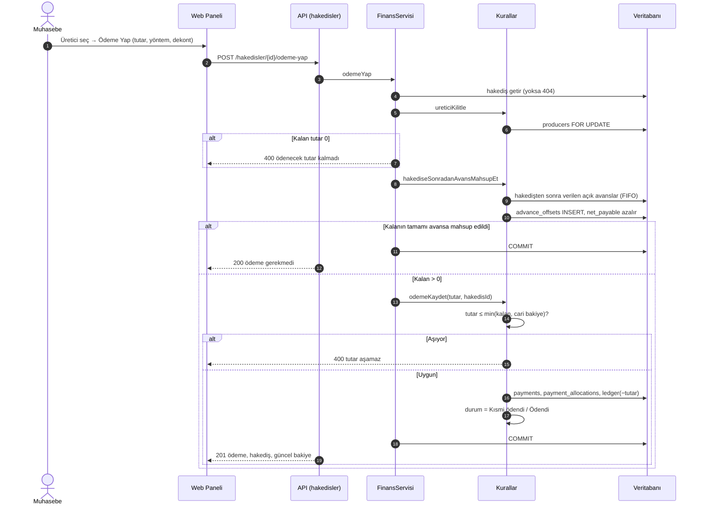

---

## 6. Etkinlik diyagramı — Hakediş hesabı ve avans mahsubu

`Kurallar.hakedisOlustur` algoritması.

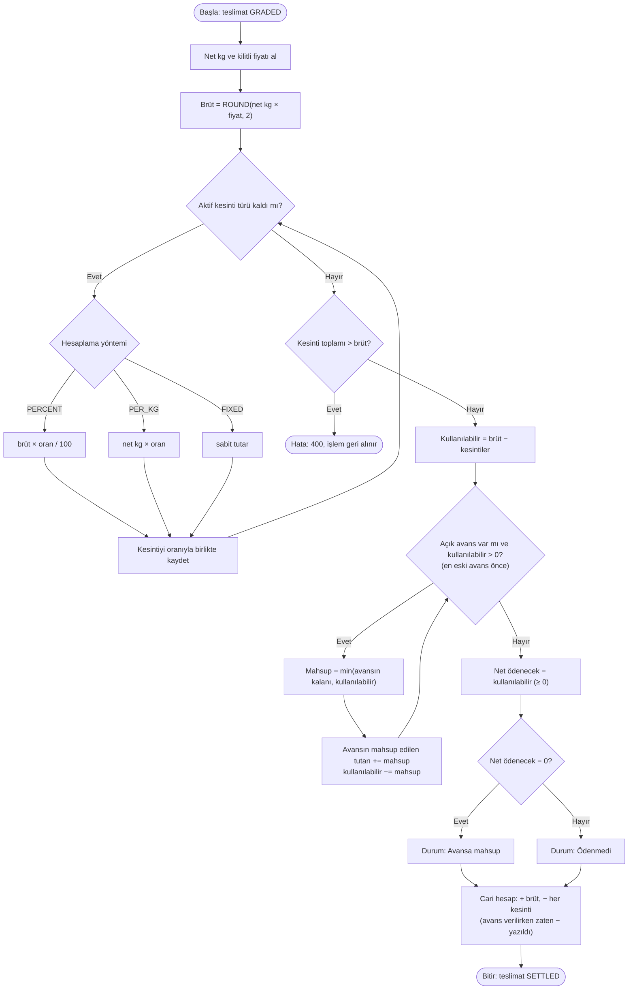

> Kapanmayan avans açık kalır; cari bakiye eksi görünür ve bir sonraki hakedişte aynı döngü kalan avansı düşer.

---

## 7. Durum diyagramları

### 7.1 Teslimat (`WeighTicket.status`)
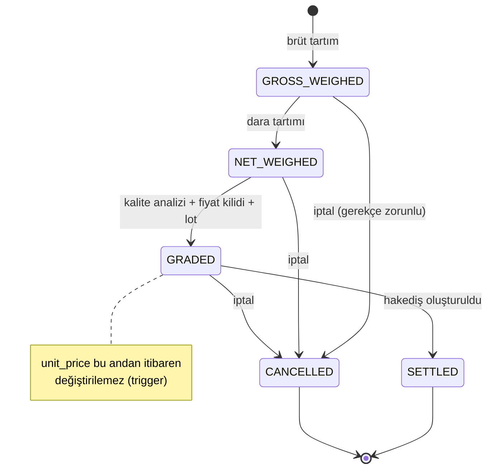
> Panelde "Fişi Kes", ilk dört durumu tek transaction'da geçer. Ara durumlar kalite analizinin sonradan yapıldığı akışlar için alan katmanında mevcuttur.

### 7.2 Hakediş (`Settlement.status`)
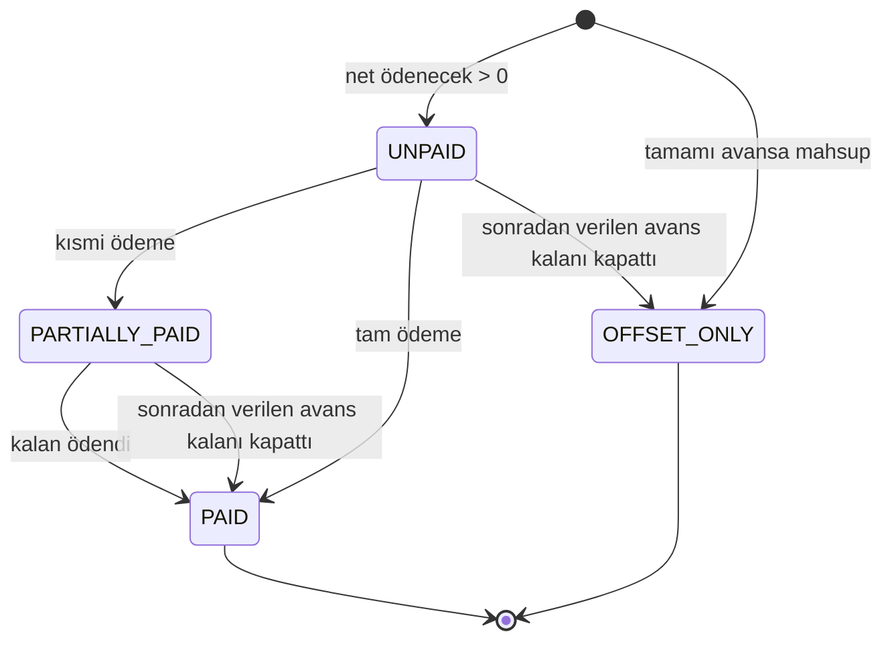

### 7.3 Günlük fiyat (`DailyPrice.status`)
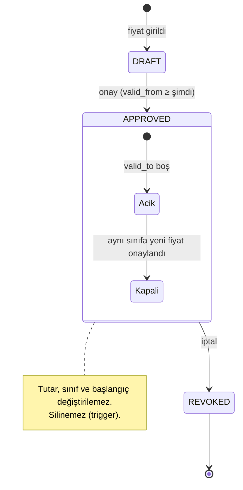

### 7.4 Avans (`Advance.status`)
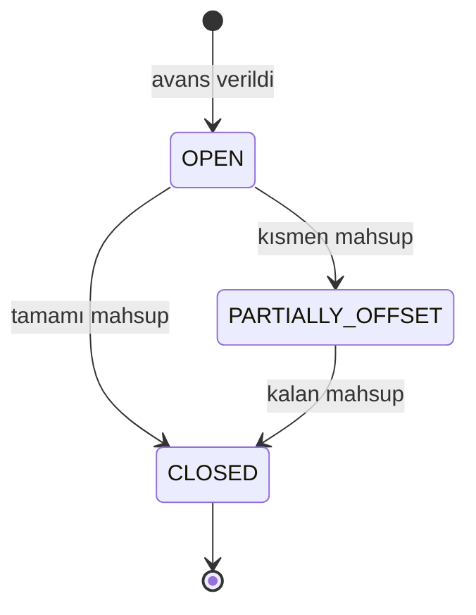

---

## 8. Bileşen ve dağıtım diyagramı

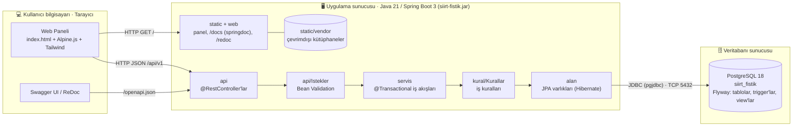

| Düğüm | Yazılım | Not |
|---|---|---|
| İstemci | Güncel bir tarayıcı (Chrome, Edge, Firefox) | Kurulum gerekmez; internet bağlantısı gerekmez |
| Uygulama sunucusu | Java 21, Spring Boot 3.3 (gömülü Tomcat) | `baslat.bat` veya `java -jar siirt-fistik.jar` |
| Veritabanı | PostgreSQL 18 | Bağlantı `.env` dosyasındaki `DATABASE_URL` ile; şema Flyway göçleriyle kurulur |
